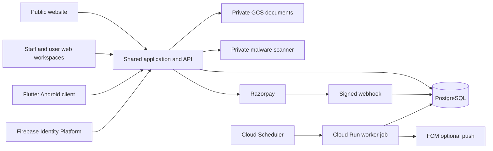

# Architecture and decisions

## Free staging option

For the current ₹0 testing target, Render Free runs the website/API, while Supabase Free provides PostgreSQL, Auth and private Storage. Google Cloud is paused. Business data stays in an unexposed `incys` schema with a restricted server role and RLS; the API validates JWT signatures, verified email, active sessions and MFA before applying domain authorization. Uploads remain quarantined until an operator runs ClamAV. In-app jobs can run from the operator CLI or a secret-protected scheduler endpoint; no hosted schedule is provisioned yet. See [free staging](free-staging.md) for configuration and limitations. The GCP diagram below remains the optional later deployment.

## Application boundary

The initial implementation uses Next.js 16 / React 19 for the public website and role workspaces. Next Route Handlers expose `/api/v1`; domain logic lives in independent TypeScript modules under `server/`. Flutter uses the same API. PostgreSQL is the system of record.

This is a modular application deployed as one Cloud Run service plus finite jobs. It is not a separate NestJS microservice deployment. The supplied documents conflict on AWS/GCP and on the need for always-on workers. The later GCP blueprint is the working reference; a single deployment avoids unnecessary service boundaries while core workflows are validated. Domain modules can be extracted after measured scaling requirements justify it.

## Integrity

- Monetary values are integer paise. Prices and commission rates are read and snapshotted by the server; client totals are ignored.
- PostgreSQL exclusion constraints reject overlapping confirmed appointments for both practitioner and patient.
- Cohort admission capacity and order stock are checked under transaction locks. Order checkout uses a customer-scoped idempotency key. Product locks are taken in sorted order.
- Verified payment events and provider payment IDs are deduplicated. Every capture and full reversal creates balanced ledger entries. A capture against a cancelled/unavailable reference becomes an unapplied receipt for refund review.
- Clinical notes, audit events and ledger entries are append-only. Correct a clinical note by referencing the superseded entry rather than changing history.
- Course cohorts reference a specific curriculum version. Adding lessons to a version with active/completed learners is refused. Certificates require all configured completion gates, including cleared fees, required lessons, assignments, attendance and published quizzes.
- Quiz answers never appear in the start payload. The server owns attempt limits, deadlines and scoring.

## Authentication and access

Development uses scrypt password hashes and opaque, SHA-256-stored sessions. Production requires Firebase ID tokens, verified email and an enabled database account. Roles are read from PostgreSQL on every request, not accepted from the browser. Staff/vendor tokens must include a second factor; the web login supports TOTP enrollment and challenge resolution.

Existing privileged accounts are never linked by matching an email alone. The first administrator is established by the operator-only bootstrap script using a verified Firebase UID. Further changes happen through the administrator workspace. Administrators have no automatic access to clinical notes or patient-report files. Documents are limited to the owner, admission administrators, or assigned clinicians as applicable.

Private files are streamed into a bounded buffer, type/signature checked, scanned by a private ClamAV service in production, then stored in a non-public GCS bucket. Authenticated downloads are audited and forced to attachments. The sample development mode bypasses scanning only for synthetic files. Missing production storage/scanner configuration fails closed.

## Events and operations

Domain transactions insert an outbox record. A finite worker reads it using `FOR UPDATE SKIP LOCKED`, records an inbox deduplication key and inserts an in-app notification in the same transaction. Scheduler invokes the job every five minutes. In-app notifications are durable; optional FCM push is best effort and currently has no retry queue. Push payloads contain no clinical content.

Pub/Sub transport, Cloud Tasks and a dead-letter queue from the draft blueprint are not implemented in this version. The database outbox preserves events until the worker commits; this is the current delivery mechanism. A future transport can publish those same events without changing transactional producers.

Expired reservations with no pending provider order are released. Reservations with a provider order remain held for finance reconciliation, because releasing them blindly can conflict with delayed payment capture. Razorpay order-creation timeouts require receipt reconciliation before retry; automatic provider reconciliation is outstanding.

## Infrastructure

Terraform defines Cloud Run, PostgreSQL 17 with backups/PITR and deletion protection, a private/versioned GCS bucket, Artifact Registry, Secret Manager grants, job invocation identities and paused scheduling. The default SQL configuration uses regional HA. Cloud SQL has no authorized IP networks and requires IAM-authorized connectors; the Cloud Run Unix socket is used. This uses connector enforcement over a public SQL endpoint, not the draft's private-IP topology.

The application may use direct VPC egress to reach a client-provisioned private scanner. Terraform does not provision that scanner, Firebase tenant/MFA settings, a load balancer/WAF, custom-domain DNS, budgets or monitoring alerts. These must be completed before production acceptance. The default database principal is also used for migrations: split the migration owner from a limited runtime role as part of deployment hardening.
